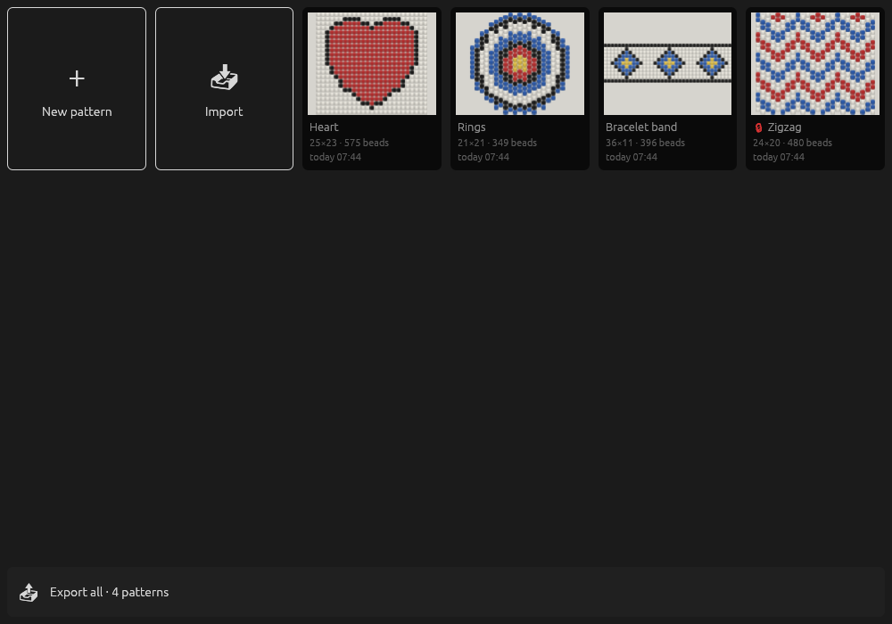
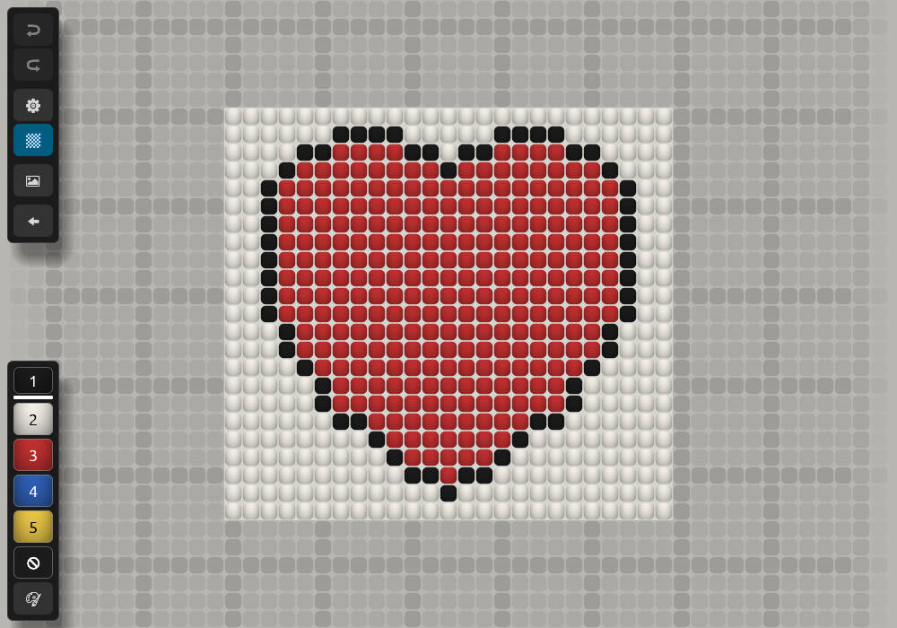
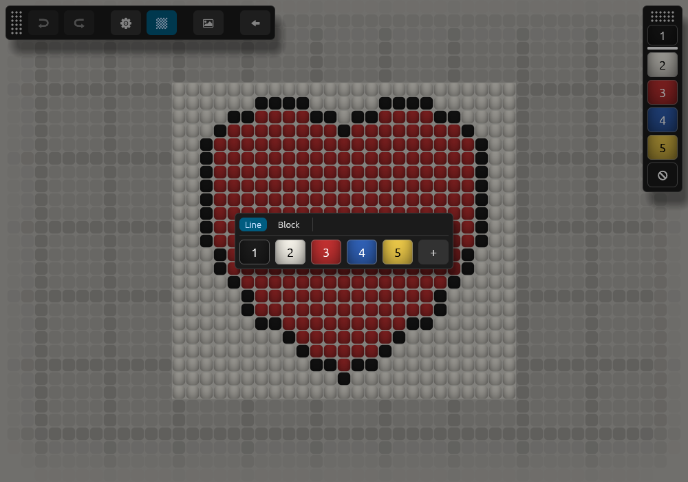
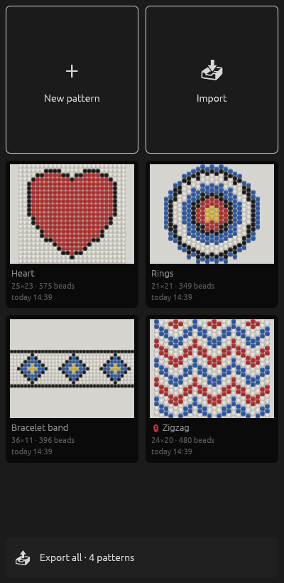
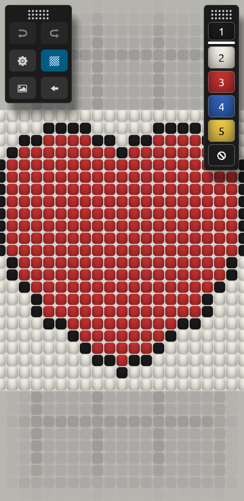

# Obusina

**[Open Obusina in the browser](https://noktoborus.github.io/obysina/)**: nothing to install; the site of the last release.

An editor of bead patterns, for Linux, Windows and Android.

| The list of patterns | A pattern, with volume | The palettes |
| --- | --- | --- |
|  |  |  |

| On a phone: the list | On a phone: a pattern |
| --- | --- |
|  |  |

The screenshots are drawn by `src/window_tests/screenshots.rs`;
`SCREENSHOTS=1 cargo test -p obusina screenshots` draws them again.

## What it does

- Opens on the list of patterns: a card for each, its picture, name, size
  and the time of its last change. A new pattern is named by the time it
  was made. A long press or the second button on a card chooses it; a tap
  then chooses or clears more. The bar on top of the chosen: export, move
  to the trash, lock or unlock, and their menu. The menu of one: rename,
  duplicate, forbid changes or unlock the card, export to a file, move to
  the trash. The menu of more says their count, and exports them in one
  `.obusiny`. A locked pattern has a red lock left of its name; it opens only to
  be looked at: no palette, and in the tools only the settings, which hold
  the volume alone, the shadows, the underlay and the way back. A trash keeps a pattern 30
  days, with "Undo" right after the move. "Export all" saves every pattern
  in one file; while patterns are chosen, the row of the trash and the
  export goes; "Import" takes `.obusina`, `.obusiny` and `.json` files.
  Search by name, the arrows, `Enter`, `Delete` and `F2` on the desktop.
- A pattern is saved by itself, with its undo and redo: a few seconds after
  the last change, on the way back to the list (the button or `Escape`),
  when the window closes and when android pauses the program.

- Draws a pattern on a field in a window. A bead is drawn at its
  proportions.
- The work area is on paper: the sheet, whose columns and rows are set in
  the menu of the settings and start at the size of the first screen, and every bead put
  past it. A bead put in the shade around grows the sheet. A bead taken
  away shrinks it to the box of the beads, never below the first screen.
  The shade reaches half the work area past it on every side. An empty
  place has no outline: only near the middle of the screen and under the
  pointer it shows the faint shadow of a bead, at every zoom. A button of
  the tools hides the shadows. A new pattern is an empty sheet.
- The panels and menus are light or dark as the system is, on Windows, on
  Android (its night mode) and in a browser. On Linux the system does not
  tell winit, and they are dark. The field keeps the paper of the pattern in both.
- The field cannot be moved off the screen: at least ten beads of it stay
  on it, at the side it was moved to, also when the window changes its
  size.
- An underlay, a picture under the beads to trace from: PNG, JPEG or WebP, its opacity
  and its four corners set by hand, so a photo taken at an angle lies
  straight. While its corners are edited, two fingers on it move, turn and
  grow it, the turn sticking to a whole quarter; over it Ctrl and the wheel
  grow it, Shift and the wheel turn it. Buttons turn it a quarter either
  way, and make its corners squarer, ten degrees a press. It is kept in the cache of the program, apart from the pattern.
- A ruling to count the beads by: every few columns and rows the shadows
  are darker. The step and the offset from cell (0, 0) are set in the menu
  of the settings and kept in the pattern.
- The menu of the settings: the grid, the turn of the canvas, the ruling,
  the size of the sheet and the background colour, each a level of its own
  whose change shows at once and can be put back; the palette settings,
  the background picture, the panels, the volume, the way back to the list. `Esc` or the way back of android
  leaves a level.
- The background colour is set in the menu of the settings and kept in
  the pattern. The shade and the shadows turn with it: darker on a light
  paper, lighter on a dark one.
- The beads have volume: round, lighter in the middle. "Volume" of the
  menu of the settings turns it off.
- Two kinds of grid: loom (and square stitch) and peyote.
- Two floating panels with no title. Any place of a panel moves it: the
  mouse pressed and moved, a finger held still and then moved. A panel
  taken is lighter, and a phone gives a short vibration. Let go at an edge,
  it stands against it. Pulled to an edge, a panel turns to it, a line or
  two lines along it, if it fits there whole; "Panels" of the menu of the
  settings chooses its view too. A line too long for the window goes on
  in the next line. The place and the view of each panel are kept, apart for
  a window that stands and one that lies. With none kept, the panels are
  stood so they fit and do not overlap, at the short edges first. The
  panels:
  - **Tools**: undo, redo, the settings, the shadows, the picture, back to
    the list; a row, a column, two rows or two columns;
  - **Beads**: the colours of the palette shown, each with the number of its
    place, and the empty place `0`. They stand as a row, a column or a
    block, as the keys of a numpad. With two palettes
    or more, buttons switch the palette. The one in hand is marked. `🎨`
    opens the window of the palettes.
- A pattern has one palette or more, each of nine places. The window of the
  palettes, opened by `🎨`, the menu of the settings or `P`, shows the places as a line or
  as a block. A tap on a place opens the picker of its colour; the colour
  stays when it is accepted. A colour is hidden or shown, its beads are
  deleted, it is moved to another palette, removed,
  or dragged onto another place, which swaps the two. A removed colour keeps
  its beads, hatched, until a colour is put in its place again. All that
  is changed while the window is open is one step of undo, made when it
  closes.
- A press on a bead switches it: to the colour in hand, or to empty when it
  has that colour already. The second button does nothing. On a touch screen
  a tap is the first button.
- The field turns by quarters: none, 90, 180 or 270 degrees, chosen in the
  menu of the settings. Only the showing turns, not the beads, so a
  turn is no step of undo. The turn is saved with the pattern, which opens
  turned as it was.
- A drag moves the field, with any button or one finger. A pinch and the wheel
  with ctrl zoom it.
- A pattern is a JSON file. Every format the program ever wrote opens.

F1 shows the keys of the screen or the menu on top, on a plate that a tap
closes. All the keys are [docs/keys.md](docs/keys.md).

## Running

```sh
cargo run                      # the list of patterns
cargo run -- my-pattern.json   # the file imported as a copy, and opened
```

The patterns are kept in the data of the program (`docs/projects.md`).

## Building

| Target | Command | Result |
| --- | --- | --- |
| Linux | `make build`, then `make install` | `target/release/obusina` |
| Windows | `make build-windows`, with mingw | `obusina.exe` |
| Android | `make apk`, `make apk-release`, `make aab` | `target/obusina.apk`, signed with the debug key; `target/obusina-release.apk`; the bundle in `android/app/build/outputs/` |
| Browser | `make web`, with trunk | the site in `target/web` |

The icon is drawn from `assets/icon.svg` at build time. On Windows it is a
resource of `obusina.exe`, built with `windres` of mingw.

Android needs the NDK, the SDK, a JDK and `cargo-ndk`, named by
`ANDROID_HOME` and `ANDROID_NDK_HOME`. `.devcontainer/Dockerfile.claude`
installs every tool these need. A release is signed as `android/README.md`
says.

## Releases

```text
make VERSION=x.y.z ──► a commit of the version, the tag vx.y.z
git push && git push origin vx.y.z ──► .github/workflows/release.yml
    ├─ the package of android, signed with the key of the secrets
    ├─ the program for Windows       ──► a release of GitHub, with all
    ├─ the program for Linux,             three
    │  x86_64 and arm64, in .tar.gz
    └─ the site of the browser       ──► GitHub Pages
```

The program for Linux is built only for a release, by `make build` on a
runner of each architecture in Debian 12 (`rust:bookworm`): it runs where
the glibc is 2.36 or newer, Raspberry Pi OS of Debian 12 among them.

Every push runs the checks and the three builds, unsigned
(`.github/workflows/ci.yml`). The key of the releases of android is in the
secrets of the repository (`android/README.md`). A release is published
only on the page of releases.

In a browser the patterns, the settings and the pictures are kept in the
private file system of the site (OPFS, `crates/unifs`), as on a disk: the
list, the trash and the saves work as elsewhere. They stay in that browser
on that device; to move them, export and import. The browser is asked to
keep them when its disk runs short. Two tabs of the site write over each
other. The page `web/index.html` shows a bar of loading while the module is
fetched (`web/loading.mjs`); the addresses are relative, so the site works
under any path.
